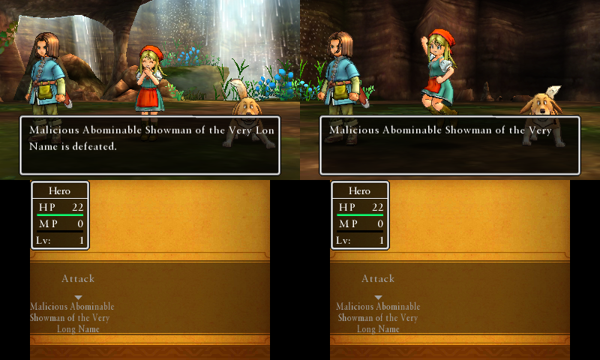

# Dragon Quest XI (3DS) – English fan translation

An English translation of the Japanese-only Nintendo 3DS version of *Dragon Quest XI*
(ドラゴンクエストXI 過ぎ去りし時を求めて), and the tool it is made with.



## Play it

**Web patcher: https://radiant-rodent.github.io/dq-xi-3ds-translation-tool/**

* **3DS with Luma3DS** (play from your cartridge): download the
  [LayeredFS patch](https://radiant-rodent.github.io/dq-xi-3ds-translation-tool/patch/DQXI_EN_layeredfs.zip),
  unzip it to the root of your SD card, enable “Enable game patching” in the Luma3DS
  configuration menu (hold SELECT while booting) and start the game from the cartridge.
* **Emulators, flash carts or an installed copy**: dump your Japanese cartridge as a
  **decrypted** `.3ds` (for example with GodMode9), open the web patcher and choose the
  file. It is read locally by your browser: nothing is uploaded and nothing is installed.
  You get either
  * a patched `.3ds` for emulators (Azahar, Citra forks) and flash carts, or
  * an installable `.cia`: install it with FBI on a 3DS with Luma3DS (which provides the
    signature patches the fakesigned CIA needs).

The patcher checks that the file is the original Japanese game before it changes anything.
It works in any current desktop browser (Chrome, Edge, Firefox, Safari): the page is plain
static HTML and JavaScript, and the patched image is assembled from your file and handed
to you as a normal download.

## What the translation changes

Besides the text itself, the game needed engine-level work to fit English:

* runtime word wrap at spaces for message, battle and help text (the game only breaks
  Japanese text at fixed points);
* articles and plurals resolved in game for monster and item names (“a Slime”,
  “3 Slimes”, “the Slime”);
* narrower Latin glyphs (taken from the European *Dragon Quest VII*) and per-label
  runtime fitting so long English labels no longer overflow their frames;
* a Latin name-entry keyboard with accented letters, Latin Save Codes, English map labels,
  texture text redrawn in English and the official English title logo;
* more memory for the UI layout heap (English layouts need more vertex buffers).

The game code patches only use ARMv6K / VFPv2 instructions, so they run on real Old 3DS
and 2DS hardware, not just emulators.

## The translation tool (`dq11tool/`)

A local web app for extracting, translating, reviewing and rebuilding the game.

```
pip install -r requirements.txt
python -m dq11tool            # or start.bat; opens http://127.0.0.1:8311/
```

* **Project**: point it at your decrypted Japanese `.3ds`; it extracts all text into a
  SQLite project in `workspace/` (gitignored).
* **Translate**: edit strings by category with previews of the in-game box sizes;
  optional machine-translation drafts through any OpenAI-compatible API, Anthropic or
  Google Translate (API keys are only stored locally in `workspace/secrets.json` if you ask).
* **Build**: writes a `.3ds`, a `.cia`, a Luma3DS LayeredFS folder and/or a browser patch
  (`.dq11patch`, see below).

Two inputs are not in this repository because they are copyrighted game assets:

* `dq11tool/data/m7_win_p14.bcfnt`, the narrow Latin font. Extract it from your own
  decrypted *Dragon Quest VII: Fragments of the Forgotten Past* (Europe) dump:
  `python -m dq11tool.fontimport "Dragon Quest VII (Europe).3ds"`
* `dq11tool/data/logo_en.png`, the English title logo artwork (optional; without it the
  Japanese logo is kept).

## The web patcher (`docs/`)

`docs/` is a static site (GitHub Pages: *Deploy from a branch*, `main`, `/docs`).
`docs/dq11patch.js` is a dependency-free ES module that re-implements the tool's
`.3ds` rebuild (`dq11tool/ctr/build.py`) and CIA builder (`dq11tool/ctr/cia.py`) in the
browser, including the BLZ compressor, the RomFS hash tree and a streaming SHA-256, and
produces byte-identical files.

A `.dq11patch` stores, for every changed file, a delta against the same file of the
player's own ROM (PACA archives and the ExeFS code are compared decompressed), so it
contains no original game data that the player does not already have.

The site serves two generated files, `docs/patch/DQXI_EN.dq11patch` and
`docs/patch/DQXI_EN_layeredfs.zip`. Regenerate both whenever the translation changes and
commit them with the change (see [CLAUDE.md](CLAUDE.md)):

```
python -m dq11tool.patchfile workspace --site docs/patch
```

The output is deterministic, so unchanged translations give byte-identical files. To check
the JavaScript patcher against the Python build:

```
python -m dq11tool.patchfile workspace --patch out.dq11patch --3ds reference.3ds
node tests/patcher_test.mjs DQXI.3ds out.dq11patch js.3ds reference.3ds
```

and, for the CIA (`reference.cia` from `dq11tool.ctr.cia.build_cia("reference.3ds", "reference.cia")`):

```
node tests/patcher_test.mjs DQXI.3ds out.dq11patch js.3ds reference.3ds js.cia reference.cia
```

## Emulator tests (`emutest/`)

Scripts that build test versions, boot them in a portable Azahar copy and drive the game
through its RPC server (no window automation). See [docs/AGENT_GUIDE.md](docs/AGENT_GUIDE.md).

## Legal

This is an unofficial fan project, not affiliated with or endorsed by Square Enix or
Nintendo. *Dragon Quest* is a registered trademark of Square Enix. You need your own copy
of the game: no ROM is distributed here. The LayeredFS download contains translated
versions of some of the game's files and only works with the original cartridge. The
source code is MIT licensed (see [LICENSE](LICENSE)).
