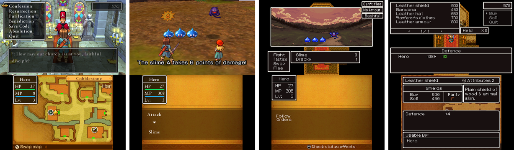

# Dragon Quest XI (3DS) English translation

A fan translation of the Japanese-only Nintendo 3DS version of *Dragon Quest XI*
(ドラゴンクエストXI 過ぎ去りし時を求めて), plus the tool used to make it.



## Play it

Web patcher: **https://radiant-rodent.github.io/dq-xi-3ds-translation-tool/**

* **3DS with Luma3DS, playing from the cartridge:** download the
  [LayeredFS patch](https://radiant-rodent.github.io/dq-xi-3ds-translation-tool/patch/DQXI_EN_layeredfs.zip),
  unzip it to the root of your SD card, turn on "Enable game patching" in the Luma3DS
  menu (hold SELECT while booting) and start the game.
* **Emulator, flash cart or installed copy:** dump your cartridge as a decrypted `.3ds`
  (GodMode9 can do this) and open it in the web patcher. You get a patched `.3ds` or an
  installable `.cia`. The file never leaves your browser.

Release notes are on the [releases page](https://github.com/radiant-rodent/dq-xi-3ds-translation-tool/releases).

## What's in it

All text is in English: story, cutscenes, NPCs, party chat, menus, battles, items,
monsters, spells, quests, books and the bestiary. Wherever the 3DS shares a line with the
official English PC release (*Dragon Quest XI S*), that translation is used as is, names
and British spelling included. 3DS-only content is translated to match.

Getting English to fit took changes to the game itself:

* Text is wrapped at spaces instead of anywhere in a word.
* Battle messages get proper articles and plurals ("The slimes are defeated.").
* Text that is too wide for its box switches to narrower letters instead of being
  squashed, so it stays sharp. The narrow Latin font comes from the European
  *Dragon Quest VII*.
* Full party names ("Veronica", "Sylvando") even though the save only fits six letters.
* Long NPC lines continue in an extra message box.
* Several windows were resized for English, and the UI gets more memory (the longer text
  crashed the item and shop menus).
* Textures with Japanese text, the map labels and the title logo are in English.
* A Latin name-entry keyboard, and Save Codes that work with Latin names.

The code patches run on real Old 3DS and 2DS hardware, not just in emulators.

## Building it yourself

```
pip install -r requirements.txt
python -m dq11tool            # or start.bat, opens http://127.0.0.1:8311/
```

The tool extracts the text from your decrypted Japanese `.3ds` into a local project, lets
you edit and review translations with previews of the in-game boxes, and builds a `.3ds`,
`.cia`, LayeredFS folder or browser patch. Machine translation drafts are optional and
use your own API key.

Two files are not included because they are game assets:

* `dq11tool/data/m7_win_p14.bcfnt`, the narrow font. Extract it from your own
  *Dragon Quest VII: Fragments of the Forgotten Past* (Europe) dump:
  `python -m dq11tool.fontimport "Dragon Quest VII (Europe).3ds"`
* `dq11tool/data/logo_en.png`, the English title logo (optional).

The web patcher in `docs/` is plain HTML and JavaScript. It rebuilds the `.3ds` and `.cia`
in the browser byte for byte like the Python tool, from a patch that only stores the
differences to your own copy of the game. After changing the translation, regenerate the
published patch files:

```
python -m dq11tool.patchfile workspace --site docs/patch
```

`emutest/` has scripts that build test versions and play them in the Azahar emulator.

## Legal

Unofficial fan project, not affiliated with Square Enix or Nintendo. *Dragon Quest* is a
trademark of Square Enix. No ROM is distributed here: you need your own copy of the game.
The source code is MIT licensed (see [LICENSE](LICENSE)).
