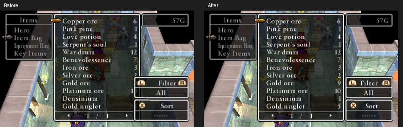
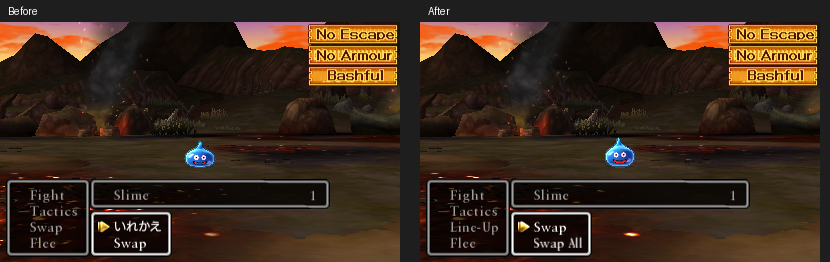
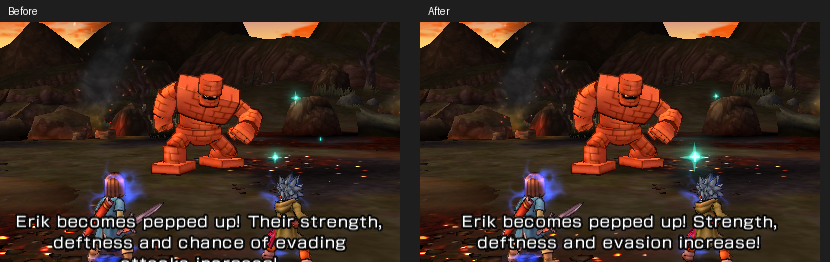

LayeredFS patch for the Dragon Quest XI (3DS) English translation. The [web patcher](https://radiant-rodent.github.io/dq-xi-3ds-translation-tool/) serves this version too.

## Fixed issues

- **Item Bag: Filter and Sort windows hid the item counts** ([#9](https://github.com/radiant-rodent/dq-xi-3ds-translation-tool/issues/9)). Both windows had been made wider for English and covered the count column of the bottom rows. They have their original width again.

- **Untranslated entry in the battle "Swap" menu** ([#8](https://github.com/radiant-rodent/dq-xi-3ds-translation-tool/issues/8)). The first entry of the window stayed Japanese (いれかえ). The battle command is now "Line-Up", as in the PC version. The window has two options: "Swap" replaces one battle member with a standby member, "Swap All" lets you choose all four members again.

- **Pep-up message ran off the screen** ([#7](https://github.com/radiant-rodent/dq-xi-3ds-translation-tool/issues/7)). The caption on the top screen holds two lines and the pep-up messages needed three. They are reworded shorter with the same meaning, e.g. "Erik becomes pepped up! Strength, deftness and evasion increase!".

## Translation tool

- Strings in the game executable that the extraction had missed (the cause of #8) are now translated from the same Japanese text elsewhere; four more were affected (an "Items" label, "Levin", "Left Hand", "Yubon").

Only the LayeredFS zip is attached.
